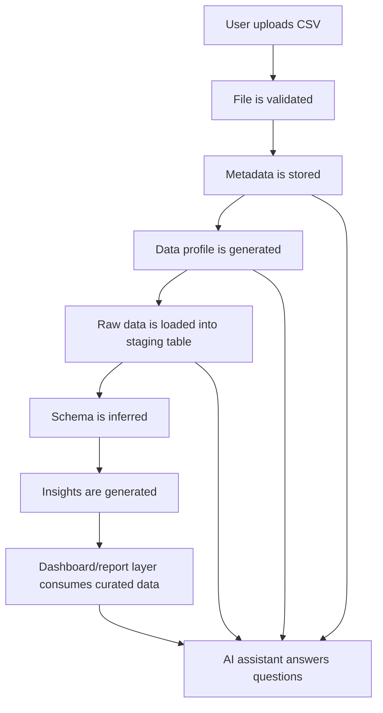

# Data Flow

The first product workflow moves a user-uploaded CSV through validation, metadata capture, profiling, warehouse loading, schema inference, insight generation, reporting, and AI-assisted querying.

## Flow Description

1. User uploads a CSV file through the frontend.
2. The FastAPI backend validates the file type, size, structure, and readability.
3. File metadata is stored in the PostgreSQL metadata database.
4. The profiling service generates column-level and dataset-level statistics.
5. Raw data is loaded into a PostgreSQL staging table.
6. The schema inference process identifies likely data types and structural patterns.
7. The insight generation process creates basic observations and warnings.
8. The dashboard and report layer consumes curated or staged warehouse data.
9. The AI assistant answers questions using dataset metadata, profile results, and warehouse queries.

## Flow Diagram

## AI Assistant Context

The AI assistant should not rely only on the raw uploaded file. It should use structured context from:

- Dataset metadata.
- Inferred schema.
- Profiling summaries.
- Data quality findings.
- Warehouse table definitions.
- Safe query results from PostgreSQL.

This keeps AI responses grounded in the platform's metadata and warehouse state.
