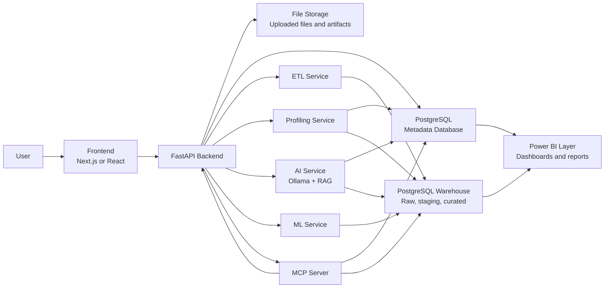

# System Architecture

DataForge AI Studio is designed as a modular local-first analytics platform. The architecture separates user interaction, API orchestration, metadata management, file processing, profiling, warehouse loading, AI services, ML services, MCP integration, and reporting.

## Core Components

| Component | Responsibility |
|---|---|
| Frontend | Provides the product interface for uploading files, previewing datasets, reviewing profiles, viewing insights, and interacting with AI-assisted features. |
| FastAPI backend | Coordinates API requests, validation, metadata operations, service calls, and workflow orchestration. |
| PostgreSQL metadata database | Stores dataset metadata, upload records, schema inference results, profiling summaries, processing status, and lineage information. |
| PostgreSQL warehouse | Stores raw staging tables, curated models, aggregates, and warehouse-ready structures. |
| File storage | Stores original uploaded files and derived artifacts such as profiles, reports, or exported outputs. |
| ETL service | Loads uploaded data into PostgreSQL staging tables and later transforms raw data into curated models. |
| Profiling service | Computes schema inference, data quality metrics, distributions, missing values, outliers, and summary statistics. |
| AI service | Supports natural-language insights, dataset summarization, and chat over metadata or warehouse context. |
| ML service | Supports forecasting, anomaly detection, clustering, classification, and other analytical models. |
| MCP server | Exposes selected platform capabilities as tools for AI agents and external MCP-compatible clients. |
| Power BI layer | Consumes curated warehouse tables or semantic-model-ready outputs for dashboarding and executive reporting. |

## Architecture Diagram

## Architectural Principles

- Metadata-driven workflows.
- PostgreSQL-first implementation.
- Local-first AI with Ollama.
- Clear separation between metadata and analytical data.
- Modular services that can evolve independently.
- Docker Compose for repeatable local development.
- Power BI as the primary executive reporting layer.
